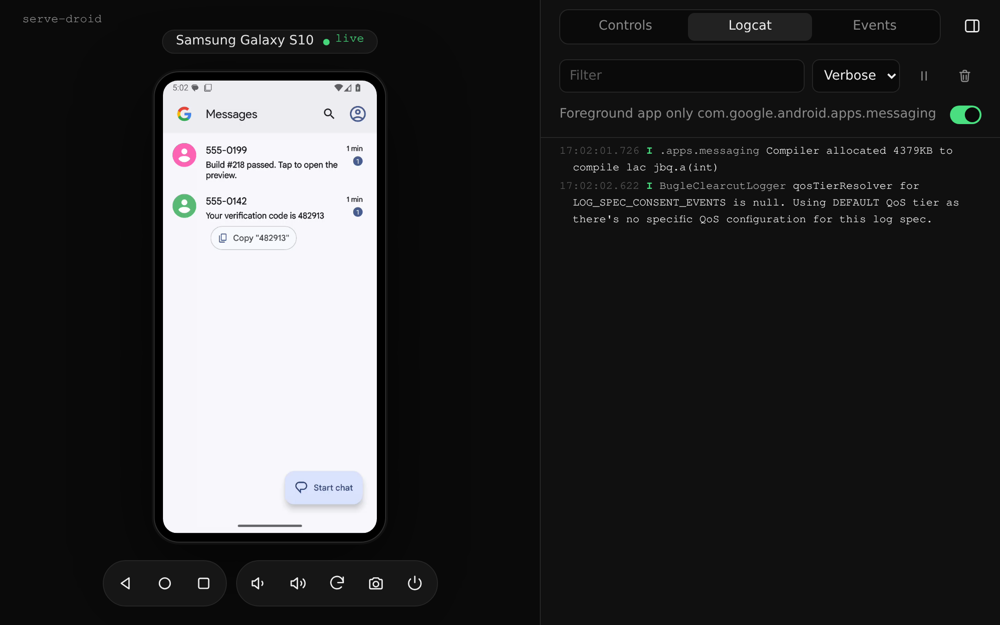

serve-droid
===========

Host an Android emulator, use it from any browser, and let AI agents control it with [WebMCP](https://webmachinelearning.github.io/webmcp/).

```sh
npx serve-droid
```

serve-droid starts an emulator for your project and prints a URL. Open the URL on a laptop, a tablet or a phone to see and use the device. An agent in the same browser tab can tap, swipe, type, read the UI tree and read logs through WebMCP tools.

| Desktop | Phone |
|---|---|
|  |  |

- **Access from anywhere.** The device streams over one HTTP port. Put it on your tailnet or behind HTTPS and use it from any device.
- **Agent control with WebMCP.** The page registers 14 tools for browser agents. No extra server or SDK.
- **One command.** Docker with KVM on Linux. Native emulators on macOS and Windows.

Quick start
-----------

Requires Node.js 22+.

| Host | Emulator | Needs |
|---|---|---|
| Linux (x86-64) | Docker container | Docker with BuildKit and `/dev/kvm` |
| macOS | Native Android emulator | Android SDK. The CLI offers to install it. |
| Windows | Native Android emulator | Android Studio and Windows Hypervisor Platform |

From your project directory:

```sh
npx serve-droid                                  # start or reuse this project's emulator
npx serve-droid --apk ./app-debug.apk            # install an APK after boot
npx serve-droid --name tablet --device "Pixel C" # a second, named emulator
npx serve-droid ls                               # running emulators and their URLs
npx serve-droid logs -f                          # follow emulator and UI logs
npx serve-droid stop                             # stop, keep apps and settings
npx serve-droid rm                               # stop and delete saved data
```

The default device is a Samsung Galaxy S10 with Android 16. The first run on Linux builds the emulator image, which takes several minutes. See the [CLI guide](./packages/serve-droid/README.md) for all options and the native setup on macOS and Windows.

Access from anywhere
--------------------

By default the browser UI listens on `127.0.0.1` only. Choose one of these ways to open it from another device.

> [!WARNING]
> The browser UI has no login. Anyone who can reach its port can control the device and install apps. Expose it only on a private network or behind your own authentication.

1. **Tailscale (recommended).** You get HTTPS, so WebMCP works on every device on your tailnet.

    ```sh
    npx serve-droid --port 6090
    tailscale serve --bg 6090
    ```

    Open `https://<machine>.<tailnet>.ts.net/`.

2. **SSH tunnel.** The browser sees a loopback address, so WebMCP works.

    ```sh
    ssh -L 6090:127.0.0.1:6090 emulator-host
    ```

    Open `http://localhost:6090/`.

3. **LAN address.** Bind to the host's address, for example `npx serve-droid --host 192.168.1.42 --port 6090`, and open `http://192.168.1.42:6090/`. Plain HTTP on a LAN address is not a secure context, so the page gets no WebMCP tools.

Any reverse proxy with HTTPS and WebSocket support also works. The UI uses relative paths, so you can serve it under a subpath.

Control with WebMCP
-------------------

The browser UI registers [WebMCP](https://webmachinelearning.github.io/webmcp/) tools when it loads. An AI agent in the same browser can then use the device like a person: read the screen, find a button, tap it and check the result.

|Tool|What it does|
|---|---|
|`get_device_info`|Model, Android version, screen size, foreground app, and battery, location, appearance and clipboard state|
|`get_ui_tree`|Visible UI elements with text, resource ids, flags, and bounds in screen pixels|
|`get_screen`|Screenshot as a base64 JPEG|
|`tap`|Tap or long-press a point|
|`swipe`|Drag from one point to another, for example to scroll|
|`type_text`|Type into the focused field|
|`press_key`|Back, home, recent apps, Enter, Backspace, arrows, volume or power|
|`rotate`|Rotate the device 90° clockwise|
|`open_url`|Open a URL in the browser or the app that handles it|
|`set_clipboard`|Replace the device clipboard|
|`set_appearance`|Switch between light and dark mode|
|`set_battery`|Simulate battery level and charging|
|`set_location`|Simulate a GPS position|
|`read_logcat`|Recent logcat lines, filtered by level, text or app|

Coordinates are screen pixels in the current orientation, as `get_ui_tree` and `get_screen` return them.

WebMCP needs:

1. A browser with WebMCP: Edge 147, or Chrome 149 with the origin trial or flag.
2. A secure context: a loopback address or HTTPS. See [Access from anywhere](#access-from-anywhere).

To check every tool against a running emulator:

```sh
npm --prefix packages/serve-droid run test:webmcp -- http://127.0.0.1:6090/
```

It prints a directory with a log of each call and screenshots.

Browser UI
----------

- **Device view.** Only the device screen, in a device frame that fits any window. Touch and drag, keyboard input and paste, rotation, and a touch cursor.
- **Toolbar.** Back, home, recent apps, volume, rotate, screenshot and power.
- **Device panel.** Device info, two-way clipboard sync, open a URL, light or dark appearance, battery and charging, GPS location, and APK install by file picker or drag and drop.
- **Logcat.** Live device logs with text, level and foreground-app filters, pause and clear.

| Logcat |
|---|
|  |

The UI talks to the emulator through its gRPC API. It streams the screen at up to about 24 fps and sends frames only when the screen changes.

Run the Docker image directly
-----------------------------

The CLI builds and runs this image for you. To manage the container yourself on a Linux host with KVM (check with `sudo apt install cpu-checker && kvm-ok`):

1. Build the image. Pick an Android version and API level from [Android versions](#android-versions).

    ```sh
    DOCKER_BUILDKIT=1 docker build -t docker-android:emulator_16.0-webui \
      --build-arg DOCKER_ANDROID_VERSION=v3.9.0-p1 \
      --build-arg EMULATOR_ANDROID_VERSION=16.0 --build-arg EMULATOR_API_LEVEL=36 \
      --secret id=extension,src=mixins/scripts/install-cli.sh \
      -f docker/emulator/Dockerfile .
    ```

    The base image `budtmo/docker-android:base_v3.9.0-p1` comes from Docker Hub. The CLI looks for the `docker-android:emulator_<version>-webui` tag, so keep it.

2. Run the container.

    ```sh
    docker run -d --name android --device /dev/kvm -p 127.0.0.1:6090:6090 \
      -e EMULATOR_DEVICE="Samsung Galaxy S10" -e WEB_UI=true -e EMULATOR_HEADLESS=true \
      -v android-emulator:/home/androidusr/emulator \
      -v android-home:/home/androidusr/.android \
      docker-android:emulator_16.0-webui
    ```

    The two volumes keep installed apps and settings when you recreate the container.

3. Open `http://localhost:6090/`. The page shows *connecting* until the emulator boots, usually in under a minute. `docker exec android cat device_status` shows the boot state.

### Configuration

|Environment variable|Default|Description|
|---|---|---|
|EMULATOR_DEVICE|Nexus 5|Device profile, see [Devices](#devices)|
|WEB_UI|false|Start the browser UI|
|WEB_UI_PORT|6090|Port of the browser UI inside the container|
|WEB_UI_MAX_EDGE|1280|Longest edge of streamed frames, in pixels|
|WEB_UI_JPEG_QUALITY|80|JPEG quality of streamed frames|
|EMULATOR_HEADLESS|false|Run the emulator without a window and skip Xvfb and VNC|
|EMULATOR_DATA_PARTITION|4g|Size of the device data partition|
|EMULATOR_ADDITIONAL_ARGS||Extra arguments for the `emulator` command|
|WEB_VNC|false|Start the original noVNC desktop view on port 6080 instead|

The upstream [configuration guide](./documentations/CUSTOM_CONFIGURATIONS.md) lists other options, such as Appium and log sharing.

### Android versions

|Android|API (`EMULATOR_API_LEVEL`)|Notes|
|---|---|---|
|9.0|28||
|10.0|29||
|11.0|30||
|12.0|32||
|13.0|33||
|14.0|34||
|15.0|35||
|16.0|36|Default|
|17.0|37.0|Use a fresh virtual device with SDK command-line tools 22.0|

The Android 17 image installs SDK command-line tools 22.0 so new virtual devices
get the correct `target=android-37.0`. Older images can write `target=android-0`,
which causes Android's graphics and system processes to crash during app switching
with software rendering. Rebuild the image and use a new device name or fresh
volumes if your existing Android 17 device was created with the older tools.

### Devices

|Type|Device|
|---|---|
|Phone|Samsung Galaxy S10, S9, S8, S7 Edge, S7, S6|
|Phone|Nexus 4, Nexus 5, Nexus One, Nexus S|
|Tablet|Nexus 7, Pixel C|

The emulator skins come from [Android Studio](https://developer.android.com/studio) and the [Samsung Developer website](https://developer.samsung.com/).

### More guides

These upstream guides still apply. They use upstream image names; use your local image instead.

- [Control the emulator from the host with adb](./documentations/USE_CASE_CONTROL_EMULATOR.md)
- [UI tests with Appium](./documentations/USE_CASE_APPIUM.md)
- [Build an Android project](./documentations/USE_CASE_BUILD_ANDROID_PROJECT.md)
- [SMS simulation](./documentations/USE_CASE_SMS.md)
- [Jenkins](./documentations/USE_CASE_JENKINS.md)

Credits
-------

serve-droid is a fork of [budtmo/docker-android](https://github.com/budtmo/docker-android) by [Budi Utomo](https://github.com/budtmo). The emulator image, its CLI and the device profiles come from that project. This fork adds:

- **The serve-droid CLI** in [`packages/serve-droid`](./packages/serve-droid), with native emulators on macOS and Windows.
- **The browser UI and its WebMCP tools** in [`packages/serve-droid/web-ui`](./packages/serve-droid/web-ui), enabled in the image with `WEB_UI=true`.
- **Android 15, 16 and 17** support.
- **No usage analytics.** The Google Form ID, the ipinfo.io lookup and the code that sent usage data were removed, as the [license](./LICENSE.md) requires for forks.
- **Bigger data partition.** `EMULATOR_DATA_PARTITION` defaults to `4g`. Android 17 fills the old `550m` default during boot. The disk image grows only as it is used.
- **Headless mode.** `EMULATOR_HEADLESS=true` passes `-no-window` to the emulator and skips Xvfb, Openbox and VNC.
- **Self-contained build.** The image builds without upstream's private build script. The Dockerfile installs `openbox`, `menu`, `sudo` and `python3-venv`, and [`mixins/scripts/install-cli.sh`](./mixins/scripts/install-cli.sh) installs the CLI.

License
-------

Copyright 2023 Budi Utomo. Released under a custom Apache 2.0 license; see [LICENSE.md](./LICENSE.md).
