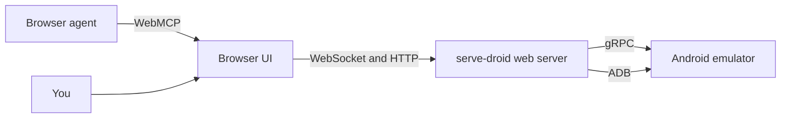

# serve-droid

The `npx serve` of Android emulators.

Host an Android emulator and use it from any browser: on your machine, on your tailnet, or on a remote Linux box you can reach from anywhere. AI agents in the browser control it with [WebMCP](https://webmachinelearning.github.io/webmcp/).

```sh
npx serve-droid
# Waiting for serve-droid-android-3f9a1c2b7e to boot…
# http://127.0.0.1:49153/
```

| Desktop | Phone |
|---|---|
|  |  |

`serve-droid` starts or reuses an Android emulator for the current project and serves a browser UI on top of it. The UI streams the screen over a WebSocket, sends your touches and keys back, and registers WebMCP tools so an agent in the same tab can drive the device. You don't need Android Studio windows, VNC or an SDK in your app.

## Features

- **Any browser, any device.** The UI fits a desktop window or a phone screen. Touch, drag, type and paste.
- **Agent-ready.** 14 [WebMCP tools](#webmcp): read the UI tree, take screenshots, tap, swipe, type, read logcat and more.
- **Host it anywhere.** Everything goes through one HTTP port, so you can put it on your tailnet or behind a reverse proxy.
- **One emulator per project.** Your apps and settings are still there next time.
- **Device panel.** Clipboard sync, open a URL, dark mode, battery, GPS, and drag and drop to install an APK.
- **Logcat in the browser.** Filter by text, level or foreground app.
- **Linux, macOS and Windows.** Docker with KVM on Linux. Native emulators on macOS and Windows.


## Why?

Emulators are stuck on the machine that runs them. To use one, an agent or a teammate needs the SDK, a desktop session and hardware that can run it. `serve-droid` turns an emulator into a URL. Run it on a Linux server, open it from your laptop or phone, and give an agent the same tab.

## Install

Requires [Node.js](https://nodejs.org/) 22+. There's nothing to install globally: `npx serve-droid` downloads the CLI.

| Host | Emulator | Needs |
|---|---|---|
| Linux (x86-64) | Docker container | Docker with BuildKit, and `/dev/kvm` |
| macOS | Native emulator | Android SDK. The CLI offers to install it. |
| Windows | Native emulator | Android Studio and Windows Hypervisor Platform |

## What happens when you run it

```sh
cd my-app
npx serve-droid
```

1. **First run on Linux:** the CLI builds the emulator image. This takes several minutes and needs network access. All projects share the image after that.
2. **Boot:** a headless Samsung Galaxy S10 with Android 16 starts. Progress goes to stderr. Booting usually takes under a minute.
3. **URL:** when Android and the UI are ready, the CLI prints the URL to stdout and exits. The emulator keeps running.
4. **Next run:** the CLI finds the same emulator (it uses the Git root to identify the project) and prints its URL right away.
5. **`stop`:** shuts the emulator down and keeps its apps and data. **`rm`** deletes them.

Only the URL goes to stdout, so you can use the command in scripts:

```sh
open "$(npx serve-droid)"
```

On macOS and Windows, the CLI uses a running emulator or boots an existing AVD. If there's none, it creates one. The first run asks before it installs anything. See the [CLI guide](./packages/serve-droid/README.md#native-emulators-on-macos-and-windows).

## WebMCP

When the page loads, it registers its tools with [WebMCP](https://webmachinelearning.github.io/webmcp/) (`navigator.modelContext`). An agent in the browser sees them like any other MCP tools. You don't need an extra server, an SDK or ADB on the agent's side.

1. Run `npx serve-droid`.
2. Open the URL in a browser with WebMCP: Edge 147, or Chrome 149 with the origin trial or flag.
3. Ask your browser agent to use the device. For example: *"Open the Settings app and turn on dark mode."*

The agent typically calls `get_ui_tree` to find a target, then `tap`, and then `get_screen` to check the result. You can watch each tap land as a cursor on the device.

| Tool | What it does |
|---|---|
| `get_device_info` | Model, Android version, screen size, foreground app, and battery, location, appearance and clipboard state |
| `get_ui_tree` | Visible UI elements with text, resource ids, flags, and bounds in screen pixels |
| `get_screen` | Screenshot as a base64 JPEG |
| `tap` | Tap or long-press a point |
| `swipe` | Drag from one point to another, for example to scroll |
| `type_text` | Type into the focused field |
| `press_key` | Back, home, recent apps, Enter, Backspace, arrows, volume or power |
| `rotate` | Rotate 90° clockwise |
| `open_url` | Open a URL in the browser or the app that handles it |
| `set_clipboard` | Replace the device clipboard |
| `set_appearance` | Light or dark mode |
| `set_battery` | Simulate battery level and charging |
| `set_location` | Simulate a GPS position |
| `read_logcat` | Recent logcat lines, filtered by level, text or app |

Coordinates are screen pixels in the current orientation, as `get_ui_tree` and `get_screen` return them.

> [!IMPORTANT]
> WebMCP works only in a secure context: `localhost`, `127.0.0.1` or HTTPS. A plain-HTTP LAN address like `http://192.168.1.42:6090/` shows the device but registers no tools. For remote use, see [Remote access](#remote-access).

## Remote access

The UI listens on `127.0.0.1` by default. Pick a fixed port and expose it:

```sh
# Tailscale: HTTPS on your tailnet, WebMCP works
npx serve-droid --port 6090
tailscale serve --bg 6090
# → https://<machine>.<tailnet>.ts.net/

# SSH tunnel: looks like localhost to the browser, WebMCP works
ssh -L 6090:127.0.0.1:6090 my-server
# → http://localhost:6090/

# LAN: plain HTTP, no WebMCP
npx serve-droid --host 192.168.1.42 --port 6090
# → http://192.168.1.42:6090/
```

Any reverse proxy with HTTPS and WebSocket support works. The UI uses relative paths, so you can serve it under a subpath.

> [!WARNING]
> The UI has no login. Anyone who can reach the port can control the device and install apps. Keep it on a private network or put your own authentication in front of it.

## CLI

```
serve-droid [start]          Start or reuse this project's emulator and print its URL
serve-droid stop             Stop the emulator and keep its apps and data
serve-droid ls               List running emulators and their URLs
serve-droid logs [-f]        Show emulator and browser UI logs (-f to follow)
serve-droid rm [-y]          Stop the emulator and delete its data
serve-droid attach           Run the browser UI in the foreground (macOS and Windows)

  --name NAME                Named emulator (default: current project)
  --device PROFILE           Device profile (default: Samsung Galaxy S10)
  --android VERSION          Android 9–17 (default: 16)
  --host IP                  Bind address (default: 127.0.0.1)
  --port PORT                Browser port (default: a free port on Linux, 6090 native)
  --apk FILE                 Install an APK after boot
  --image IMAGE              Use a compatible Docker image instead of building one
  --serial SERIAL            Native emulator to use (macOS and Windows)
```

### Examples

```sh
# Install your build after boot
npx serve-droid --apk ./app/build/outputs/apk/debug/app-debug.apk

# A tablet next to the phone
npx serve-droid --name tablet --device "Pixel C"

# An older Android
npx serve-droid --name legacy --android 11

# What's running?
npx serve-droid ls
```

The [CLI guide](./packages/serve-droid/README.md) has the details: native setup, Python setup, Android 17 notes and releases.

## How it works



- **Linux:** the emulator and a small Python web server run in one Docker container with `/dev/kvm`. The CLI publishes the server's port 6090.
- **macOS and Windows:** the same web server runs locally against a native emulator's gRPC endpoint and ADB serial.
- The server streams JPEG frames at up to about 24 fps and only when the screen changes. Input goes back over gRPC. APK installs and logcat go through ADB.
- The WebMCP tools call the web server's HTTP API (`api/tap`, `api/ui`, `api/logcat` and others).

## Docker image

The CLI builds and runs the image for you. To manage the container yourself:

```sh
DOCKER_BUILDKIT=1 docker build -t docker-android:emulator_16.0-webui \
  --build-arg DOCKER_ANDROID_VERSION=v3.9.0-p1 \
  --build-arg EMULATOR_ANDROID_VERSION=16.0 --build-arg EMULATOR_API_LEVEL=36 \
  --secret id=extension,src=mixins/scripts/install-cli.sh \
  -f docker/emulator/Dockerfile .

docker run -d --name android --device /dev/kvm -p 127.0.0.1:6090:6090 \
  -e EMULATOR_DEVICE="Samsung Galaxy S10" -e WEB_UI=true -e EMULATOR_HEADLESS=true \
  -v android-emulator:/home/androidusr/emulator \
  -v android-home:/home/androidusr/.android \
  docker-android:emulator_16.0-webui
```

Open `http://localhost:6090/`. The volumes keep apps and settings when you recreate the container. The CLI looks for the `docker-android:emulator_<version>-webui` tag, so keep that name if you want the CLI to use your build.

<details>
<summary>Environment variables</summary>

| Variable | Default | Description |
|---|---|---|
| `EMULATOR_DEVICE` | Nexus 5 | Device profile (the CLI defaults to Samsung Galaxy S10) |
| `WEB_UI` | false | Start the browser UI |
| `WEB_UI_PORT` | 6090 | Browser UI port inside the container |
| `WEB_UI_MAX_EDGE` | 1280 | Longest edge of streamed frames, in pixels |
| `WEB_UI_JPEG_QUALITY` | 80 | JPEG quality of streamed frames |
| `EMULATOR_HEADLESS` | false | No emulator window. Skips Xvfb, Openbox and VNC. |
| `EMULATOR_DATA_PARTITION` | 4g | Size of the device data partition |
| `EMULATOR_ADDITIONAL_ARGS` | | Extra arguments for `emulator` |
| `WEB_VNC` | false | Start the original noVNC desktop view on port 6080 instead |

The upstream [configuration guide](./documentations/CUSTOM_CONFIGURATIONS.md) lists more options, such as Appium.

</details>

<details>
<summary>Android versions and devices</summary>

| Android | API (`EMULATOR_API_LEVEL`) | Notes |
|---|---|---|
| 9.0 – 14.0 | 28, 29, 30, 32, 33, 34 | |
| 15.0 | 35 | |
| 16.0 | 36 | Default |
| 17.0 | 37.0 | Use a fresh virtual device |

The Android 17 image installs SDK command-line tools 22.0 so new virtual devices get `target=android-37.0`. Devices created with older tools can get `target=android-0`, which makes system processes crash during app switching. Use a new `--name` or fresh volumes for those.

| Type | Devices |
|---|---|
| Phone | Samsung Galaxy S10, S9, S8, S7 Edge, S7, S6; Nexus 4, Nexus 5, Nexus One, Nexus S |
| Tablet | Nexus 7, Pixel C |

Skins come from [Android Studio](https://developer.android.com/studio) and the [Samsung Developer website](https://developer.samsung.com/).

</details>

<details>
<summary>Upstream guides</summary>

These still apply. They use upstream image names; use your local image instead.

- [Control the emulator from the host with adb](./documentations/USE_CASE_CONTROL_EMULATOR.md)
- [UI tests with Appium](./documentations/USE_CASE_APPIUM.md)
- [Build an Android project](./documentations/USE_CASE_BUILD_ANDROID_PROJECT.md)
- [SMS simulation](./documentations/USE_CASE_SMS.md)
- [Jenkins](./documentations/USE_CASE_JENKINS.md)

</details>

## Development

```sh
npm exec --package=./packages/serve-droid -- serve-droid    # run the CLI from this checkout
npm --prefix packages/serve-droid run test:e2e              # boot, reuse, stop and restart a disposable emulator
npm --prefix packages/serve-droid run test:webmcp -- http://127.0.0.1:6090/   # call every WebMCP tool
```

Both tests print where they saved their screenshots. See [Release](./packages/serve-droid/README.md#release) to publish.

## Credits

serve-droid is a fork of [budtmo/docker-android](https://github.com/budtmo/docker-android) by [Budi Utomo](https://github.com/budtmo). The emulator image, its Python CLI and the device profiles come from that project. This fork adds the serve-droid CLI, the browser UI and its WebMCP tools, native emulators on macOS and Windows, Android 15–17, headless mode, a 4 GB default data partition and a self-contained image build. It also removes upstream's usage analytics, as the [license](./LICENSE.md) requires for forks.

## License

Copyright 2023 Budi Utomo. Released under a custom Apache 2.0 license; see [LICENSE.md](./LICENSE.md).
