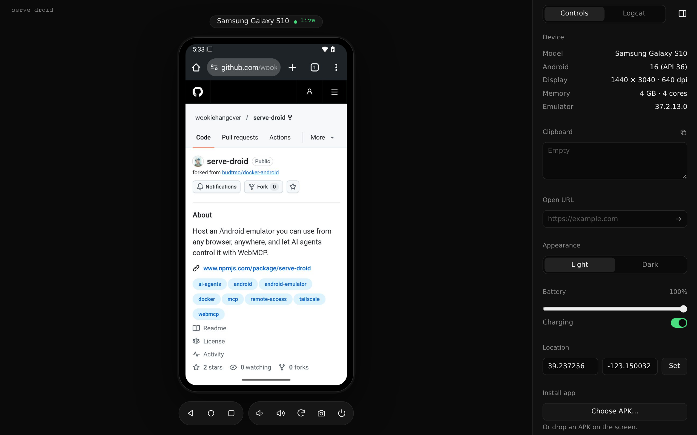
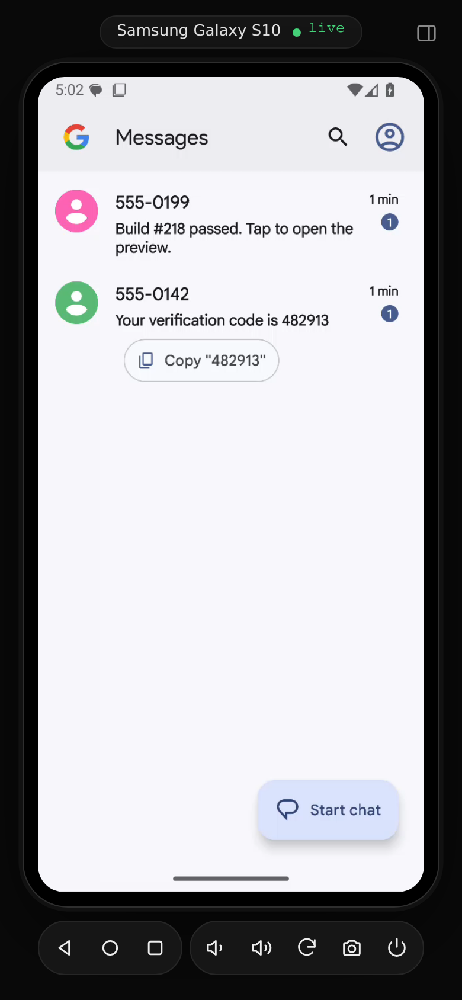

docker-android
==============

Android emulator in Docker with a responsive browser UI. Run it on a Linux host with KVM, then use the device from any browser, including a phone.

On macOS, [attach the browser UI to a running Android Studio emulator](./packages/serve-droid/README.md#attach-to-android-studio-on-macos).

This is a fork of [budtmo/docker-android](https://github.com/budtmo/docker-android) by [Budi Utomo](https://github.com/budtmo). The emulator image, CLI and device profiles come from that project. See [Changes from upstream](#changes-from-upstream) for what this fork adds.

| Desktop | Phone |
|---|---|
|  |  |

Features
--------

- **Device view.** Only the device screen, in a device frame that fits any window. Touch and drag, keyboard input and paste, rotation, and a circular touch cursor.
- **Toolbar.** Back, home, recent apps, volume, rotate, screenshot and power.
- **Device panel.** Device info, two-way clipboard sync, open a URL, light or dark appearance, battery level and charging, GPS location, and APK install by file picker or drag and drop.
- **Logcat.** Live device logs with text, level and foreground-app filters, pause and clear.
- **Headless.** With `EMULATOR_HEADLESS=true` the emulator runs without a window, so Xvfb, Openbox and VNC do not start.

| Logcat |
|---|
|  |

The browser UI talks to the emulator through its built-in gRPC API and streams the screen at up to about 24 fps. It sends frames only when the screen changes.

Requirements
------------

- Linux host with hardware virtualization. Check it with `sudo apt install cpu-checker && kvm-ok`.
- Docker with BuildKit.

Quick start
-----------

With Node.js 22+ on the Docker host, start an emulator from this checkout:

    npm exec --package=./packages/serve-droid -- serve-droid

Open the URL it prints. The [serve-droid CLI](./packages/serve-droid) supports APK install,
named devices, and custom ports. To build and run the image directly, follow the steps below.

1. Build the image. Pick an Android version and its API level from [Android versions](#android-versions).

    ```
    DOCKER_BUILDKIT=1 docker build -t docker-android:emulator_16.0-webui \
      --build-arg DOCKER_ANDROID_VERSION=v3.9.0-p1 \
      --build-arg EMULATOR_ANDROID_VERSION=16.0 --build-arg EMULATOR_API_LEVEL=36 \
      --secret id=extension,src=mixins/scripts/install-cli.sh \
      -f docker/emulator/Dockerfile .
    ```

    The base image `budtmo/docker-android:base_v3.9.0-p1` comes from Docker Hub.

2. Run the container.

    ```
    docker run -d --name android --device /dev/kvm -p 6080:6090 \
      -e EMULATOR_DEVICE="Samsung Galaxy S10" -e WEB_UI=true -e EMULATOR_HEADLESS=true \
      docker-android:emulator_16.0-webui
    ```

3. Open ***http://localhost:6080***. The page shows *connecting* until the emulator boots, usually in under a minute.

4. Check the emulator status at any time.

    ```
    docker exec android cat device_status
    ```

Persisting data
---------------

The emulated device is created again when the container is recreated. To keep installed apps and settings, mount volumes for the device and its adb keys:

```
docker run ... \
  -v android-emulator:/home/androidusr/emulator \
  -v android-home:/home/androidusr/.android \
  docker-android:emulator_16.0-webui
```

Configuration
-------------

|Environment variable|Default|Description|
|---|---|---|
|EMULATOR_DEVICE|Nexus 5|Device profile, see [Devices](#devices)|
|WEB_UI|false|Start the browser UI|
|WEB_UI_PORT|6090|Port of the browser UI inside the container|
|WEB_UI_MAX_EDGE|1280|Longest edge of streamed frames, in pixels|
|WEB_UI_JPEG_QUALITY|80|JPEG quality of streamed frames|
|EMULATOR_HEADLESS|false|Run the emulator without a window and skip Xvfb and VNC|
|EMULATOR_DATA_PARTITION|4g|Size of the device data partition|
|EMULATOR_ADDITIONAL_ARGS||Extra arguments for the `emulator` command|
|WEB_VNC|false|Start the original noVNC desktop view on port 6080 instead|

The upstream [configuration guide](./documentations/CUSTOM_CONFIGURATIONS.md) lists the other options, such as Appium and log sharing.

Android versions
----------------

|Android|API (`EMULATOR_API_LEVEL`)|Notes|
|---|---|---|
|9.0|28||
|10.0|29||
|11.0|30||
|12.0|32||
|13.0|33||
|14.0|34||
|15.0|35||
|16.0|36|Recommended|
|17.0|37.0|Use a fresh virtual device with SDK command-line tools 22.0|

The Android 17 image installs SDK command-line tools 22.0 so new virtual devices
get the correct `target=android-37.0`. Older images can write `target=android-0`,
which causes Android's graphics and system processes to crash during app switching
with software rendering. Rebuild the image and use a new device name or fresh
volumes if your existing Android 17 device was created with the older tools.

Devices
-------

|Type|Device|
|---|---|
|Phone|Samsung Galaxy S10, S9, S8, S7 Edge, S7, S6|
|Phone|Nexus 4, Nexus 5, Nexus One, Nexus S|
|Tablet|Nexus 7, Pixel C|

The emulator skins come from [Android Studio](https://developer.android.com/studio) and the [Samsung Developer website](https://developer.samsung.com/).

Changes from upstream
---------------------

- **Browser UI** in [`packages/serve-droid/web-ui`](./packages/serve-droid/web-ui), enabled with `WEB_UI=true`.
- **Android 15, 16 and 17** support.
- **No usage analytics.** The Google Form ID, the ipinfo.io lookup and the code that sent usage data were removed, as the [license](./LICENSE.md) requires for forks.
- **Bigger data partition.** `EMULATOR_DATA_PARTITION` defaults to `4g`. Android 17 fills the old `550m` default during boot. The disk image grows only as it is used.
- **Headless mode** passes `-no-window` to the emulator.
- **Self-contained build.** The image builds without upstream's private build script. The Dockerfile installs `openbox`, `menu`, `sudo` and `python3-venv`, and [`mixins/scripts/install-cli.sh`](./mixins/scripts/install-cli.sh) installs the CLI.

More guides
-----------

These upstream guides still apply. They use upstream image names; use your local image instead.

- [Control the emulator from the host with adb](./documentations/USE_CASE_CONTROL_EMULATOR.md)
- [UI tests with Appium](./documentations/USE_CASE_APPIUM.md)
- [Build an Android project](./documentations/USE_CASE_BUILD_ANDROID_PROJECT.md)
- [SMS simulation](./documentations/USE_CASE_SMS.md)
- [Jenkins](./documentations/USE_CASE_JENKINS.md)

License
-------

Copyright 2023 Budi Utomo. Released under a custom Apache 2.0 license; see [LICENSE.md](./LICENSE.md).
