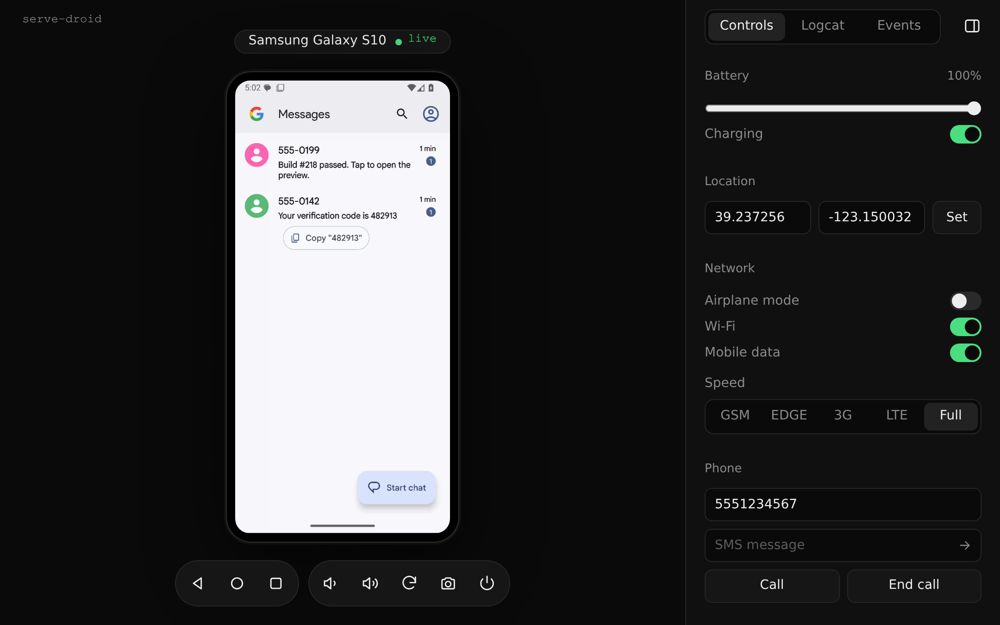
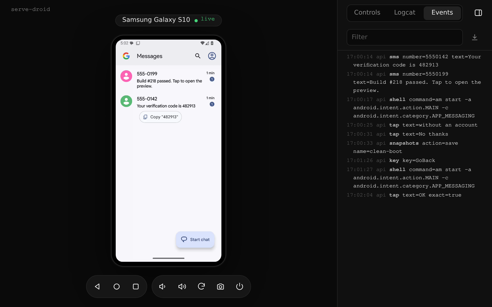
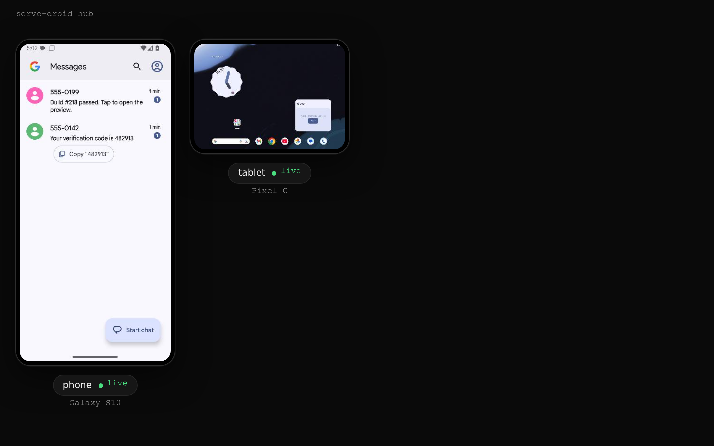
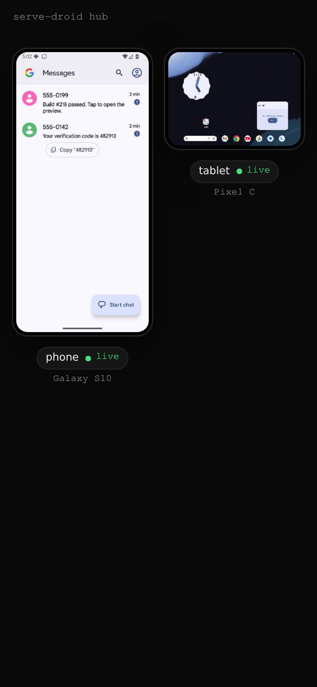
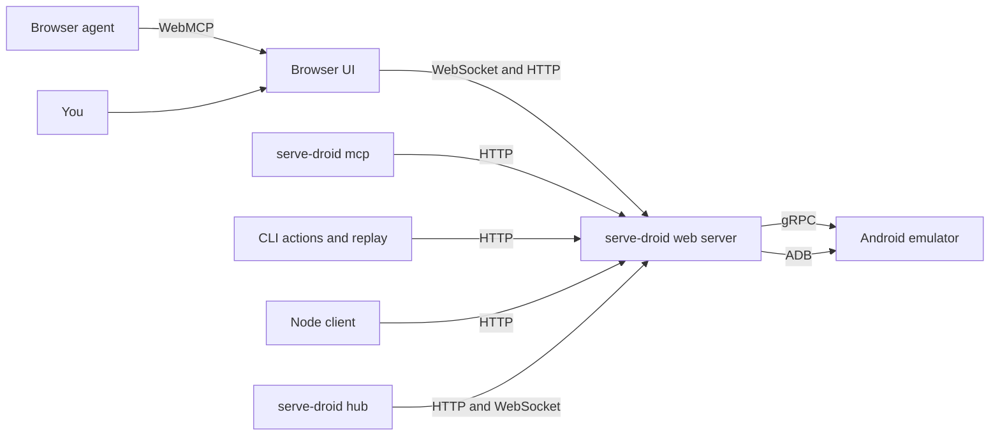

# serve-droid

The `npx serve` of Android emulators.

Host an Android emulator and use it from any browser: on your machine, on your tailnet, or on a remote Linux box you can reach from anywhere. AI agents control it with [WebMCP](https://webmachinelearning.github.io/webmcp/) in the browser, or with `serve-droid mcp` from Claude Code, Cursor or Codex.

```sh
npx serve-droid
# Waiting for serve-droid-android-3f9a1c2b7e to boot…
# http://127.0.0.1:49153/
```

| Desktop | Phone |
|---|---|
|  |  |

`serve-droid` starts or reuses an Android emulator for the current project and serves a browser UI on top of it. The UI streams the screen over a WebSocket, sends your touches and keys back, and registers WebMCP tools so an agent in the same tab can drive the device. The same tools are available over stdio MCP, as CLI commands and from a typed Node client. You don't need Android Studio windows, VNC or an SDK in your app.

## Features

- **Any browser, any device.** The UI fits a desktop window or a phone screen. Touch, drag, type, paste, scroll with the wheel, pinch with two fingers or Alt-drag, and long-press.
- **Agent-ready.** 28 [agent tools](#agent-tools) from one manifest: tap by text, wait for an element, read the UI tree, screenshots, pinch, apps, snapshots, network and more.
- **Every way in.** WebMCP in the browser, [`serve-droid mcp`](#mcp-for-claude-code-cursor-and-codex) over stdio, [CLI commands](#cli-actions), and a [typed Node client](#node-client-and-middleware).
- **Record and replay.** Every action goes into an event log. Export it as a script and replay it from the CLI.
- **Host it anywhere.** Everything goes through one HTTP port, so you can put it on your tailnet or behind a reverse proxy. Add `--token` for a login. H.264 video uses about 7× less bandwidth than JPEG.
- **All emulators on one page.** [`serve-droid hub`](#hub) shows every running emulator as a live tile behind one port.
- **One emulator per project.** Your apps and settings are still there next time. Snapshots save and restore a state in seconds.
- **Device panel.** Apps, snapshots, SMS and calls, network speed and airplane mode, font scale, clipboard sync, dark mode, battery, GPS routes, and drag and drop to install an APK.
- **Logcat and events in the browser.** Filter logcat by text, level or foreground app. Watch every action live in the Events tab.
- **Linux, macOS and Windows.** Docker with KVM on Linux. Native emulators on macOS and Windows.

| Device controls | Events | Logcat |
|---|---|---|
|  |  |  |

## Why?

Emulators are stuck on the machine that runs them. To use one, an agent or a teammate needs the SDK, a desktop session and hardware that can run it. `serve-droid` turns an emulator into a URL. Run it on a Linux server, open it from your laptop or phone, and give an agent the same tab.

## Install

Requires [Node.js](https://nodejs.org/) 22+. There's nothing to install globally: `npx serve-droid` downloads the CLI.

| Host | Emulator | Needs |
|---|---|---|
| Linux (x86-64) | Docker container | Docker with BuildKit, and `/dev/kvm` |
| macOS | Native emulator | Android SDK. The CLI offers to install it. |
| Windows | Native emulator | Android Studio and Windows Hypervisor Platform |

Check a machine before the first start:

```sh
npx serve-droid doctor
```

It checks Node, Git, Docker access, BuildKit, `/dev/kvm`, the emulator image, disk and memory on Linux, or the Android SDK, an AVD, acceleration and Python on macOS and Windows. Each problem comes with a fix. It changes nothing, makes no network calls, and exits 1 when a required check fails (`--json` for scripts).

## What happens when you run it

```sh
cd my-app
npx serve-droid
```

1. **First run on Linux:** the CLI builds the emulator image. This takes several minutes and needs network access. All projects share the image after that.
2. **Boot:** a headless Samsung Galaxy S10 with Android 16 starts. Progress goes to stderr. Booting usually takes under a minute.
3. **URL:** when Android and the UI are ready, the CLI prints the URL to stdout and exits. The emulator keeps running.
4. **Next run:** the CLI finds the same emulator (it uses the Git root to identify the project) and prints its URL right away. After an update that changes the image, it rebuilds the image once and moves the emulator onto it, keeping apps and data.
5. **`stop`:** shuts the emulator down and keeps its apps and data. **`rm`** deletes them.

Only the URL goes to stdout, so you can use the command in scripts:

```sh
open "$(npx serve-droid)"
```

On macOS and Windows, the CLI uses a running emulator or boots an existing AVD. If there's none, it creates one. The first run asks before it installs anything. See the [CLI guide](./packages/serve-droid/README.md#native-emulators-on-macos-and-windows).

## Agent tools

One manifest ([`web-ui/tools.json`](./packages/serve-droid/web-ui/tools.json)) describes every tool. The browser page registers them with WebMCP, and `serve-droid mcp` serves the same list over stdio, so both kinds of agents see the same 28 tools.

| Tool | What it does |
|---|---|
| `get_device_info` | Model, Android version, screen size, foreground app, and battery, location, appearance and clipboard state |
| `get_ui_tree` | Visible UI elements with text, resource ids, flags, and bounds in screen pixels |
| `get_screen` | Screenshot as a JPEG image |
| `find_elements` | Find elements by text, resource id, description or class |
| `tap` | Tap or long-press a point, or an element by text, id or description |
| `wait_for` | Wait until an element appears (or disappears), with a timeout |
| `swipe` | Drag from one point to another |
| `scroll` | Scroll like a mouse wheel, without a fling |
| `pinch` | Two-finger pinch to zoom in or out |
| `type_text` | Type into the focused field |
| `press_key` | Back, home, recent apps, Enter, Backspace, arrows, volume or power |
| `rotate` | Switch between portrait and landscape |
| `open_url` | Open a URL or deep link |
| `set_clipboard` | Replace the device clipboard |
| `set_appearance` | Light or dark mode |
| `set_battery` | Simulate battery level and charging |
| `set_location` | Set a GPS position, or play a route of points |
| `read_logcat` | Recent logcat lines, filtered by level, text or app |
| `list_apps` | Installed packages |
| `manage_app` | Launch, stop, clear data or uninstall an app |
| `snapshot` | List, save, load or delete emulator snapshots |
| `send_sms` | Receive an SMS from a number |
| `phone_call` | Incoming call, accept, end, hold or busy |
| `touch_fingerprint` | Touch the fingerprint sensor |
| `set_network` | Airplane mode, Wi-Fi, mobile data, network speed and delay |
| `set_accessibility` | Font scale, display density, locale and TalkBack |
| `get_events` | Recent actions from the event log |
| `run_shell` | Run an `adb shell` command |

Coordinates are screen pixels in the current orientation, as `get_ui_tree` and `get_screen` return them. Selectors (`text`, `id`, `desc`, `class`) match a case-insensitive substring unless `exact` is set; `text` also matches the content description. Agents usually call `tap {text: "Settings"}` and `wait_for` instead of guessing coordinates.

`serve-droid mcp` adds `install_apk {path}`, which reads an APK from your computer.

### WebMCP in the browser

When the page loads, it registers the tools with [WebMCP](https://webmachinelearning.github.io/webmcp/) (`navigator.modelContext`). An agent in the browser sees them like any other MCP tools. You don't need an extra server, an SDK or ADB on the agent's side.

1. Run `npx serve-droid`.
2. Open the URL in a browser with WebMCP: Edge 147, or Chrome 149 with the origin trial or flag.
3. Ask your browser agent to use the device. For example: *"Open the Settings app and turn on dark mode."*

You can watch each tap land as a cursor on the device, and each call appears in the Events tab.

> [!IMPORTANT]
> WebMCP works only in a secure context: `localhost`, `127.0.0.1` or HTTPS. A plain-HTTP LAN address like `http://192.168.1.42:6090/` shows the device but registers no tools. For remote use, see [Remote access](#remote-access).

### MCP for Claude Code, Cursor and Codex

`serve-droid mcp` is a stdio MCP server. It finds the project's running emulator (or the one you name), loads `tools.json` from it, and forwards each call to its HTTP API.

```sh
# Claude Code
claude mcp add android -- npx serve-droid mcp --start

# Any MCP client (mcp.json / settings.json)
{ "mcpServers": { "android": { "command": "npx", "args": ["serve-droid", "mcp", "--start"] } } }
```

- `--start` boots the project's emulator first if it isn't running.
- `--name NAME` picks a named emulator. `--url URL` (or `SERVE_DROID_URL`) uses any serve-droid URL, including a remote one with `?token=`.
- Logs go to stderr. Tool errors come back as MCP tool errors the agent can read.

## Remote access

The UI listens on `127.0.0.1` by default. Pick a fixed port and expose it:

```sh
# Tailscale: HTTPS on your tailnet, WebMCP works
npx serve-droid --port 6090 --token
tailscale serve --bg 6090
# → https://<machine>.<tailnet>.ts.net/

# SSH tunnel: looks like localhost to the browser, WebMCP works
ssh -L 6090:127.0.0.1:6090 my-server
# → http://localhost:6090/

# LAN: plain HTTP, no WebMCP
npx serve-droid --host 192.168.1.42 --port 6090
# → http://192.168.1.42:6090/
```

Any reverse proxy with HTTPS and WebSocket support works. The UI uses relative paths, so you can serve it under a subpath.

### Token

`serve-droid start --token` makes a random token and prints a URL that carries it:

```sh
npx serve-droid --port 6090 --token
# http://127.0.0.1:6090/?token=3b0c…
```

- Opening that URL once sets an HttpOnly, SameSite=Strict cookie and redirects to the plain URL. Without the token, the page, the API and the WebSocket answer 401.
- Scripts send `Authorization: Bearer <token>`. The CLI, `serve-droid mcp` and the Node client read the token from the URL, and `serve-droid ls` prints it.
- Each `start` of a Docker emulator makes a new token; `stop` revokes it. For your own container, set `WEB_UI_TOKEN`.

The server also refuses cross-site requests (a page on another origin can't call the API), with or without a token.

> [!WARNING]
> Without `--token`, anyone who can reach the port can control the device, run shell commands and install apps. Use `--token` whenever the port is reachable by others, or put your own authentication in front of it.

### Video

The page picks the video codec itself:

- **H.264** over WebCodecs when the browser supports it (needs a secure context). A still screen sends nothing; a scroll used about 0.5 MB/s in our test, against 3.4 MB/s for JPEG.
- **JPEG** frames everywhere else. This is also what `get_screen` and `api/frame` return.

Add `?codec=jpeg` or `?codec=h264` to the URL to choose. `WEB_UI_H264_BITRATE` sets the H.264 bit rate in Mbit/s (default 4).

## Hub

`serve-droid hub` serves one page with a live tile for every running emulator. Click a tile to open that emulator's full UI. Each emulator is proxied under `/d/<name>/`, so one port and one `tailscale serve` cover all of them, and WebMCP works on each.

```sh
npx serve-droid --name phone
npx serve-droid --name tablet --device "Pixel C"
npx serve-droid hub --token          # default port 6089
tailscale serve --bg 6089
```

| Desktop | Phone |
|---|---|
|  |  |

The hub adds each emulator's own token for you. Anyone who can reach the hub can use every emulator behind it, so use `--token` when others can reach it.

## CLI

```
serve-droid [start]          Start or reuse this project's emulator and print its URL
serve-droid stop             Stop the emulator and keep its apps and data
serve-droid ls               List running emulators and their URLs
serve-droid logs [-f]        Show emulator and browser UI logs (-f to follow)
serve-droid rm [-y]          Stop the emulator and delete its data
serve-droid attach           Run the browser UI in the foreground (macOS and Windows)
serve-droid doctor [--json]  Check this machine's dependencies and say how to fix each problem
serve-droid mcp [--start]    Serve MCP over stdio for agents
serve-droid hub              One page for every running emulator (--port, default 6089)

  --name NAME                Named emulator (default: current project)
  --device PROFILE           Device profile (default: Samsung Galaxy S10)
  --android VERSION          Android 9–17 (default: 16)
  --host IP                  Bind address (default: 127.0.0.1)
  --port PORT                Browser port (default: a free port on Linux, 6090 native)
  --apk FILE                 Install an APK after boot
  --image IMAGE              Use a compatible Docker image instead of building one
  --serial SERIAL            Native emulator to use (macOS and Windows)
  --token                    Require a token; the printed URL carries it
  --url URL                  Use a running serve-droid at this URL (mcp, hub and actions)
```

### Examples

```sh
# Install your build after boot
npx serve-droid --apk ./app/build/outputs/apk/debug/app-debug.apk

# A tablet next to the phone
npx serve-droid --name tablet --device "Pixel C"

# An older Android
npx serve-droid --name legacy --android 11

# What's running?
npx serve-droid ls
```

### CLI actions

These commands drive the running emulator, so shell scripts and CI jobs can use it without an agent. Pick the emulator with `--name` or `--url`, and add `--json` for JSON output.

```
screenshot [FILE]          Save a PNG (- writes to stdout)
ui                         List the visible, actionable UI nodes
find [TEXT]                Find nodes by --text, --id, --desc or --class
tap X Y | tap TEXT         Tap a point or an element (--duration MS for a long press)
wait [TEXT]                Wait for an element (--timeout MS, --gone); exits 1 on timeout
swipe X1 Y1 X2 Y2          Swipe between points, or swipe up|down|left|right
type TEXT                  Type into the focused field
key KEY                    home, back, recents, Enter, Tab, ArrowDown, Power, …
open URL                   Open a URL or deep link
apps                       List installed third-party apps (--all for every package)
launch PACKAGE             Launch an app (also: app stop|clear|uninstall PACKAGE)
snapshot ls|save|load|delete [NAME]
sms NUMBER TEXT            Receive an SMS
call NUMBER [ACTION]       Incoming call, or accept|end|hold|busy
geo LAT LNG | geo --stop   Set the GPS location or stop a route
network                    Show or change --speed, --delay, --airplane, --wifi, --data
shell COMMAND…             Run an adb shell command (use -- before flags: shell -- am start -a …)
events [--export FILE]     Show recent events, or save them as a replay script
replay FILE [--speed N]    Replay an exported script (N > 1 is faster)
```

```sh
# A smoke test in CI
npx serve-droid --apk app-debug.apk
npx serve-droid launch com.example.app
npx serve-droid wait "Sign in" --timeout 20000
npx serve-droid tap --text "Sign in"
npx serve-droid screenshot signed-in.png
```

### Record and replay

The server logs every action: API calls, agent tool calls, and your own taps and swipes in the browser (as `tap` and `swipe` in screen pixels). The Events tab shows them live and has an export button.

```sh
npx serve-droid events --export flow.json   # or Export in the Events tab
npx serve-droid replay flow.json --speed 2
```

A script is `{version: 1, device, steps: [{t, action, ...params}]}`. `t` is milliseconds since the first step, and replay posts each step to `api/<action>`. When the body has its own `t`, `action` or `params` field (`app`, `phone`, `snapshots`), the step nests it as `{t, action, params: {...}}`. Edit a script to swap coordinates for selectors such as `{"action": "tap", "text": "Display"}` so it survives layout changes.

### Node client and middleware

```js
import { connect } from 'serve-droid/client';

const droid = connect(process.env.SERVE_DROID_URL);   // the URL may carry ?token=
await droid.launch('com.android.settings');
await droid.waitFor({ text: 'Network' });
await droid.tap({ text: 'Network' });
await writeFile('network.png', await droid.screenshot());
```

The client covers every endpoint and ships TypeScript types. Errors throw `ServeDroidError` with the HTTP `status`.

`serve-droid/middleware` mounts the UI inside your dev server (Connect, Express, Vite, Metro or plain `node:http`), so the app and the emulator share one origin:

```js
import { droidMiddleware } from 'serve-droid/middleware';

const droid = droidMiddleware({ basePath: '/.droid', url: process.env.SERVE_DROID_URL });
app.use(droid);
server.on('upgrade', (req, socket, head) => droid.handleUpgrade(req, socket, head));
```

The [CLI guide](./packages/serve-droid/README.md) has the details: native setup, Python setup, Android 17 notes and releases.

## How it works



- **Linux:** the emulator and a small Python web server run in one Docker container with `/dev/kvm`. The CLI publishes the server's port 6090.
- **macOS and Windows:** the same web server runs locally against a native emulator's gRPC endpoint and ADB serial.
- The server streams H.264 (from `screenrecord`) or JPEG frames (from gRPC), and only while someone watches. With no viewer it encodes nothing. Input goes back over gRPC, including multi-touch. APK installs, logcat, apps and shell go through ADB.
- The Python server owns every device capability and publishes them as an HTTP API plus `tools.json`. WebMCP, `serve-droid mcp`, the CLI, the Node client and the hub are thin clients of that API.

## Docker image

The CLI builds and runs the image for you. To manage the container yourself:

```sh
DOCKER_BUILDKIT=1 docker build -t docker-android:emulator_16.0-webui \
  --build-arg DOCKER_ANDROID_VERSION=v3.9.0-p1 \
  --build-arg EMULATOR_ANDROID_VERSION=16.0 --build-arg EMULATOR_API_LEVEL=36 \
  --secret id=extension,src=mixins/scripts/install-cli.sh \
  -f docker/emulator/Dockerfile .

docker run -d --name android --device /dev/kvm -p 127.0.0.1:6090:6090 \
  -e EMULATOR_DEVICE="Samsung Galaxy S10" -e WEB_UI=true -e EMULATOR_HEADLESS=true \
  -v android-emulator:/home/androidusr/emulator \
  -v android-home:/home/androidusr/.android \
  docker-android:emulator_16.0-webui
```

Open `http://localhost:6090/`. The volumes keep apps and settings when you recreate the container. The CLI looks for the `docker-android:emulator_<version>-webui` tag, so keep that name if you want the CLI to use your build.

<details>
<summary>Environment variables</summary>

| Variable | Default | Description |
|---|---|---|
| `EMULATOR_DEVICE` | Nexus 5 | Device profile (the CLI defaults to Samsung Galaxy S10) |
| `WEB_UI` | false | Start the browser UI |
| `WEB_UI_PORT` | 6090 | Browser UI port inside the container |
| `WEB_UI_MAX_EDGE` | 1280 | Longest edge of streamed frames, in pixels |
| `WEB_UI_JPEG_QUALITY` | 80 | JPEG quality of streamed frames |
| `WEB_UI_H264_BITRATE` | 4 | H.264 bit rate in Mbit/s |
| `WEB_UI_TOKEN` | | Require this token for the page, API and WebSocket |
| `EMULATOR_HEADLESS` | false | No emulator window. Skips Xvfb, Openbox and VNC. |
| `EMULATOR_DATA_PARTITION` | 4g | Size of the device data partition |
| `EMULATOR_ADDITIONAL_ARGS` | | Extra arguments for `emulator` |
| `WEB_VNC` | false | Start the original noVNC desktop view on port 6080 instead |

The upstream [configuration guide](./documentations/CUSTOM_CONFIGURATIONS.md) lists more options, such as Appium.

</details>

<details>
<summary>Android versions and devices</summary>

| Android | API (`EMULATOR_API_LEVEL`) | Notes |
|---|---|---|
| 9.0 – 14.0 | 28, 29, 30, 32, 33, 34 | |
| 15.0 | 35 | |
| 16.0 | 36 | Default |
| 17.0 | 37.0 | Use a fresh virtual device |

The Android 17 image installs SDK command-line tools 22.0 so new virtual devices get `target=android-37.0`. Devices created with older tools can get `target=android-0`, which makes system processes crash during app switching. Use a new `--name` or fresh volumes for those.

| Type | Devices |
|---|---|
| Phone | Samsung Galaxy S10, S9, S8, S7 Edge, S7, S6; Nexus 4, Nexus 5, Nexus One, Nexus S |
| Tablet | Nexus 7, Pixel C |

Skins come from [Android Studio](https://developer.android.com/studio) and the [Samsung Developer website](https://developer.samsung.com/).

</details>

<details>
<summary>Upstream guides</summary>

These still apply. They use upstream image names; use your local image instead.

- [Control the emulator from the host with adb](./documentations/USE_CASE_CONTROL_EMULATOR.md)
- [UI tests with Appium](./documentations/USE_CASE_APPIUM.md)
- [Build an Android project](./documentations/USE_CASE_BUILD_ANDROID_PROJECT.md)
- [SMS simulation](./documentations/USE_CASE_SMS.md)
- [Jenkins](./documentations/USE_CASE_JENKINS.md)

</details>

## Development

```sh
npm exec --package=./packages/serve-droid -- serve-droid    # run the CLI from this checkout
npm --prefix packages/serve-droid run test:e2e              # boot, reuse, stop and restart a disposable emulator
npm --prefix packages/serve-droid run test:webmcp -- http://127.0.0.1:6090/   # call every WebMCP tool
npm --prefix packages/serve-droid run test:agent -- "$(npx serve-droid --name e2e --token)" --name e2e   # CLI, MCP, client, replay, token, hub
```

Each test prints a directory with screenshots and a JSON log of every call. Pull requests run [CI](./.github/workflows/serve-droid-ci.yml): `node --check`, Python compile, `ruff` and a check of `tools.json`.

### Known limits

- **SMS and phone calls** need an image built from this release or later. Older images keep the cellular radio off (`phone_call` fails with "the radio is off"). The CLI rebuilds stale images itself; for an image you manage, rebuild it.
- **Locale** changes need a rootable image (Google APIs). Play images return an error.
- **Rotation** switches between portrait and landscape only; the images ignore upside-down.
- Two-finger pinch on a real touch screen uses the same code as Alt-drag but hasn't been tested on hardware. See [Release](./packages/serve-droid/README.md#release) to publish.

## Credits

serve-droid is a fork of [budtmo/docker-android](https://github.com/budtmo/docker-android) by [Budi Utomo](https://github.com/budtmo). The emulator image, its Python CLI and the device profiles come from that project. This fork adds the serve-droid CLI, the browser UI and its WebMCP tools, native emulators on macOS and Windows, Android 15–17, headless mode, a 4 GB default data partition and a self-contained image build. It also removes upstream's usage analytics, as the [license](./LICENSE.md) requires for forks. The H.264 stream parser is ported from [serve-avd](https://github.com/hsandhu/serve-avd) (Apache-2.0).

## License

Copyright 2023 Budi Utomo. Released under a custom Apache 2.0 license; see [LICENSE.md](./LICENSE.md).
